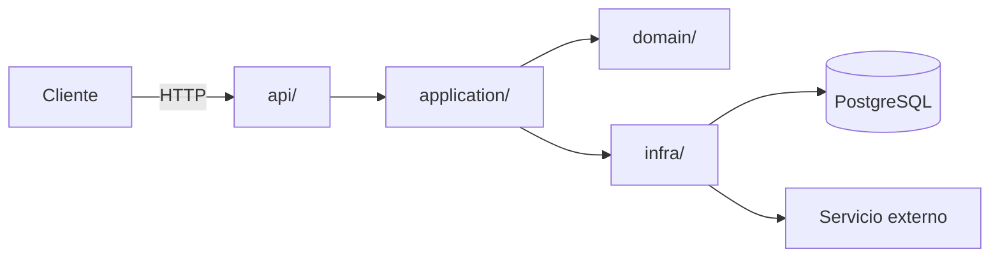

<!--
PLANTILLA de docs/ARCHITECTURE.md
Cómo usarla:
- Rellena las secciones y borra estos comentarios y los ejemplos que no apliquen.
- Escribe para alguien (persona o agente) que llega nuevo y tiene que saber DÓNDE está cada cosa y QUÉ no puede romper.
- Mantenlo corto: solo lo que cambia poco. Lo volátil (estado, TODOs, versiones) va en issues o en docs/plans/.
- Nombra módulos y conceptos en lugar de enlazar a líneas concretas: los enlaces finos se quedan obsoletos.
- Si una regla se puede comprobar con una herramienta (lint, test, CI), compruébala; este documento explica el porqué.
-->

# Arquitectura de <nombre-del-proyecto>

> Última revisión: AAAA-MM-DD · Responsable: @<persona-o-equipo>

## 1. Propósito y alcance

<!-- 2-3 frases. Qué problema resuelve el sistema y qué queda explícitamente FUERA. Para el "cómo arrancarlo", enlaza al README. -->

<nombre> es un <servicio/librería/CLI> que <hace X> para <usuarios Y>.
**Fuera de alcance:** <p. ej. no gestiona pagos; no expone UI>.

## 2. Visión general

<!-- Un diagrama sencillo de los componentes principales y cómo se comunican. Mermaid lo renderizan GitHub/GitLab y los agentes lo leen como texto. -->



## 3. Mapa del código

<!-- La sección más útil para los agentes: dónde buscar cada cosa. Una línea por módulo. Si no sabes dónde iría algo nuevo, esta tabla debería resolverlo. -->

| Ruta | Responsabilidad | Notas |
|---|---|---|
| `src/<pkg>/domain/` | Entidades, value objects y reglas de negocio puras | Sin E/S ni dependencias de frameworks |
| `src/<pkg>/application/` | Casos de uso: orquestan el dominio y los puertos | Un módulo por caso de uso |
| `src/<pkg>/infra/` | Adaptadores: BD, APIs externas, colas, ficheros | Implementan los puertos definidos en `application/` |
| `src/<pkg>/api/` | Entrada HTTP/CLI: validación, serialización, auth | Sin lógica de negocio |
| `src/<pkg>/config.py` | Carga y validación de configuración (variables de entorno) | Único punto de lectura del entorno |
| `tests/unit/` | Tests rápidos sin E/S | Espejo de `src/` |
| `tests/integration/` | Tests contra BD y servicios reales (contenedores) | Más lentos; se ejecutan en CI |
| `scripts/` | Utilidades reproducibles (`check.sh`, migraciones, seeds) | |

**¿Dónde va algo nuevo?** <p. ej. "Una regla de negocio → `domain/`. Una llamada a un servicio externo → un puerto en `application/ports.py` más un adaptador en `infra/`.">

## 4. Capas y reglas de dependencia

<!-- Qué puede importar qué. Es la regla que más rompen los agentes, porque copian el patrón más cercano. Hazla cumplir con import-linter o un test de arquitectura. -->

```
api  ──►  application  ──►  domain
infra ──►  application  ──►  domain
```

- `domain` no importa nada del proyecto ni de frameworks (solo la stdlib y <librerías permitidas>).
- `application` depende de `domain` y de **interfaces** (puertos), nunca de `infra`.
- `api` e `infra` no se importan entre sí; se conectan en `<pkg>/bootstrap.py`.

**Cómo se verifica:** contratos de `import-linter` en `pyproject.toml` (`[tool.importlinter]`), que se ejecutan en `scripts/check.sh` y en CI.

## 5. Principios innegociables

<!--
Sustituye a la constitution.md de Spec Kit si no lo usáis.
Pocos (5-10), estables y verificables. Cada uno con su porqué (ADR) y cómo se comprueba.
Romper uno exige un ADR nuevo que lo cambie, no una excepción silenciosa.
Los agentes deben revisar su plan contra esta lista antes de implementar (lo indica AGENTS.md).
-->

| ID | Principio | Por qué | Cómo se verifica |
|---|---|---|---|
| P1 | El dominio no tiene E/S ni dependencias de frameworks | Testeable y portable ([ADR-0002](adr/0002-arquitectura-hexagonal.md)) | import-linter |
| P2 | Test primero: no se mergea código de producción sin un test que lo cubra | Los tests son el oráculo de los agentes ([ADR-0003](adr/0003-tdd.md)) | Revisión de PR + umbral de coverage en CI |
| P3 | Tipado estricto en todo `src/` | Documentación ejecutable que el agente puede comprobar | `mypy --strict` en CI |
| P4 | La configuración solo se lee en `config.py`, y se valida al arrancar | Evitar `os.environ` disperso y fallos tardíos | Regla de ruff / grep en CI |
| P5 | Ninguna dependencia nueva sin justificarla en la PR (o en un ADR si es estructural) | Superficie de ataque y mantenimiento | Revisión de `pyproject.toml`/`uv.lock` en la PR |
| P6 | Sin secretos en el repositorio | Seguridad | gitleaks en pre-commit y CI |
| P7 | <tu principio> | <porqué / ADR> | <herramienta o revisión> |

## 6. Invariantes

<!-- Cosas que siempre son verdad en el sistema, sobre todo las "ausencias" (lo que NO existe a propósito), que no se ven leyendo el código. -->

- Todas las fechas se guardan y transportan en UTC con zona horaria (`datetime` aware).
- Los importes monetarios son `Decimal`, nunca `float`.
- `domain/` **no** tiene ningún `async`; la concurrencia vive en `infra/` y `api/`.
- No hay estado global mutable salvo <X>.
- <tu invariante>

## 7. Flujo principal

<!-- Recorrido de una petición o caso de uso típico, de la entrada a la salida. 5-10 pasos. -->

1. `api/` recibe la petición, la valida (Pydantic) y la traduce a un comando.
2. El caso de uso de `application/` carga las entidades a través de un repositorio (puerto).
3. `domain/` aplica las reglas y devuelve el nuevo estado o eventos.
4. `application/` persiste mediante el puerto y publica eventos si los hay.
5. `api/` serializa la respuesta.

## 8. Modelo de dominio y glosario

<!-- Términos del negocio con significado preciso. Evita que personas y agentes usen sinónimos para la misma cosa (o la misma palabra para dos cosas). -->

| Término | Significado | En el código |
|---|---|---|
| <Reserva> | <definición precisa> | `domain/booking.py::Booking` |
| <Trayecto> | <definición precisa> | `domain/trip.py::Trip` |

## 9. Integraciones externas

| Sistema | Para qué | Adaptador | Fallo esperado y cómo se gestiona |
|---|---|---|---|
| PostgreSQL | Persistencia | `infra/db/` | Reintentos en conexión; transacción por caso de uso |
| <API externa> | <uso> | `infra/<x>_client.py` | Timeout de N s, reintentos con backoff, circuit breaker |

## 10. Aspectos transversales

- **Errores:** las excepciones de dominio heredan de `DomainError`; `api/` las traduce a códigos HTTP en un único manejador.
- **Logging:** estructurado (JSON) con `<structlog/logging>`; nunca se registran datos personales ni secretos.
- **Configuración:** variables de entorno documentadas en `.env.example`; validación en `config.py`.
- **Seguridad:** <auth, autorización, validación de entradas, datos sensibles>.
- **Observabilidad:** <métricas, trazas, health checks>.
- **Tests:** pirámide unit > integration > e2e; los de integración usan servicios reales en contenedores, no mocks de la BD.

## 11. Decisiones

Las decisiones con su contexto y las alternativas descartadas están en [`docs/adr/`](adr/README.md). Este documento describe **el estado actual**; los ADR explican **por qué** es así.

## 12. Mantenimiento de este documento

- Se actualiza **en la misma PR** que cambie la estructura, una capa, un principio o una integración.
- Cambiar un principio de la sección 5 exige un ADR.
- Revisión periódica (p. ej. trimestral) para eliminar lo obsoleto; se puede pedir a un agente que compare este documento con el código y proponga correcciones.
