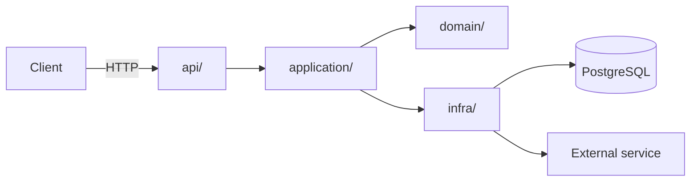

<!--
TEMPLATE for docs/ARCHITECTURE.md
How to use it:
- Fill in the sections and delete these comments and any examples that don't apply.
- Write for someone (human or agent) who is new and needs to know WHERE everything lives and WHAT they must not break.
- Keep it short: only what changes rarely. Volatile content (status, TODOs, versions) belongs in issues or docs/plans/.
- Name modules and concepts instead of linking to specific lines: fine-grained links go stale.
- If a rule can be checked by a tool (lint, test, CI), check it there; this document explains the why.
-->

# <project-name> architecture

> Last reviewed: YYYY-MM-DD · Owner: @<person-or-team>

## 1. Purpose and scope

<!-- 2-3 sentences. What problem the system solves and what is explicitly OUT of scope. For "how to run it", link to the README. -->

<name> is a <service/library/CLI> that <does X> for <users Y>.
**Out of scope:** <e.g. it does not handle payments; it has no UI>.

## 2. Overview

<!-- A simple diagram of the main components and how they communicate. GitHub/GitLab render Mermaid, and agents read it as text. -->



## 3. Code map

<!-- The most useful section for agents: where to look for each thing. One line per module. If you don't know where something new goes, this table should answer it. -->

| Path | Responsibility | Notes |
|---|---|---|
| `src/<pkg>/domain/` | Entities, value objects and pure business rules | No I/O, no framework dependencies |
| `src/<pkg>/application/` | Use cases: orchestrate the domain and the ports | One module per use case |
| `src/<pkg>/infra/` | Adapters: DB, external APIs, queues, files | Implement the ports defined in `application/` |
| `src/<pkg>/api/` | HTTP/CLI entry points: validation, serialization, auth | No business logic |
| `src/<pkg>/config.py` | Loading and validating configuration (environment variables) | The only place that reads the environment |
| `tests/unit/` | Fast tests with no I/O | Mirrors `src/` |
| `tests/integration/` | Tests against a real DB and services (containers) | Slower; run in CI |
| `scripts/` | Reproducible utilities (`check.sh`, migrations, seeds) | |

**Where does something new go?** <e.g. "A business rule → `domain/`. A call to an external service → a port in `application/ports.py` plus an adapter in `infra/`.">

## 4. Layers and dependency rules

<!-- What can import what. This is the rule agents break most often, because they copy the nearest pattern. Enforce it with import-linter or an architecture test. -->

```
api  ──►  application  ──►  domain
infra ──►  application  ──►  domain
```

- `domain` imports nothing from the project or from frameworks (only the stdlib and <allowed libraries>).
- `application` depends on `domain` and on **interfaces** (ports), never on `infra`.
- `api` and `infra` do not import each other; they are wired together in `<pkg>/bootstrap.py`.

**How it is checked:** `import-linter` contracts in `pyproject.toml` (`[tool.importlinter]`), run by `scripts/check.sh` and in CI.

## 5. Non-negotiable principles

<!--
Replaces Spec Kit's constitution.md if you don't use Spec Kit.
Few (5-10), stable and verifiable. Each one with its why (a decision in docs/decisions/) and how it is checked.
Breaking one requires a new decision that supersedes it, not a silent exception.
Agents must check their plan against this list before implementing (AGENTS.md says so).
-->

| ID | Principle | Why | How it is checked |
|---|---|---|---|
| P1 | The domain has no I/O and no framework dependencies | Testable and portable ([D-0002](decisions/0002-hexagonal-architecture.md)) | import-linter |
| P2 | Test first: no production code is merged without a test that covers it | Tests are the agents' oracle ([D-0003](decisions/0003-tdd.md)) | PR review + coverage threshold in CI |
| P3 | Strict typing across `src/` | Executable documentation that the agent can check | `mypy --strict` in CI |
| P4 | Configuration is only read in `config.py`, and is validated at startup | Avoid scattered `os.environ` and late failures | ruff rule / grep in CI |
| P5 | No new dependency without justifying it in the PR (or in a decision if it is structural) | Attack surface and maintenance | Review of `pyproject.toml`/`uv.lock` in the PR |
| P6 | No secrets in the repository | Security | gitleaks in pre-commit and CI |
| P7 | <your principle> | <why / decision> | <tool or review> |

## 6. Invariants

<!-- Things that are always true in the system, especially "absences" (what deliberately does NOT exist), which you can't see by reading the code. -->

- All datetimes are stored and passed around in UTC, timezone-aware.
- Monetary amounts are `Decimal`, never `float`.
- `domain/` has **no** `async`; concurrency lives in `infra/` and `api/`.
- There is no mutable global state except <X>.
- <your invariant>

## 7. Main flow

<!-- Walkthrough of a typical request or use case, from entry to exit. 5-10 steps. -->

1. `api/` receives the request, validates it (Pydantic) and turns it into a command.
2. The `application/` use case loads the entities through a repository (port).
3. `domain/` applies the rules and returns the new state or events.
4. `application/` persists through the port and publishes events if any.
5. `api/` serializes the response.

## 8. Domain model and glossary

<!-- Business terms with a precise meaning. Stops humans and agents from using synonyms for the same thing (or the same word for two things). -->

| Term | Meaning | In the code |
|---|---|---|
| <Booking> | <precise definition> | `domain/booking.py::Booking` |
| <Trip> | <precise definition> | `domain/trip.py::Trip` |

## 9. External integrations

| System | Used for | Adapter | Expected failure and how it is handled |
|---|---|---|---|
| PostgreSQL | Persistence | `infra/db/` | Connection retries; one transaction per use case |
| <External API> | <use> | `infra/<x>_client.py` | N s timeout, retries with backoff, circuit breaker |

## 10. Cross-cutting concerns

- **Errors:** domain exceptions inherit from `DomainError`; `api/` maps them to HTTP status codes in a single handler.
- **Logging:** structured (JSON) with `<structlog/logging>`; personal data and secrets are never logged.
- **Configuration:** environment variables documented in `.env.example`; validated in `config.py`.
- **Security:** <authentication, authorization, input validation, sensitive data>.
- **Observability:** <metrics, traces, health checks>.
- **Tests:** pyramid unit > integration > e2e; integration tests use real services in containers, not DB mocks.

## 11. Decisions

Decisions with their context and rejected alternatives live in [`docs/decisions/`](decisions/README.md): architecture, business rules and discarded approaches. This document describes **the current state**; the decisions explain **why** it is this way.

## 12. Maintaining this document

- Update it **in the same PR** that changes the structure, a layer, a principle or an integration.
- Changing a principle in section 5 requires a decision record.
- Periodic review (e.g. quarterly) to remove what is obsolete; you can ask an agent to compare this document with the code and propose corrections.
